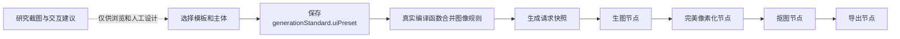

# 软件集成、参数与其他AI调用

[返回总览](README.md)。源码基线为本地Pixel Studio提交`a4bc94db0061f1121ae9acdfe8a58da0498be401`；此SHA是本地修改版本，不表示上游仓库存在同名提交。

## 软件里怎样使用

1. 在创作区打开“创作模板”，选择UI。
2. 选择背包UI、商店UI、对白UI或制作UI，再选择具体方案。
3. 查看布局示意、完整提示词，以及“游戏参考”里的实际截图和同类对比。
4. 点击“使用这个模板”会应用规范；浏览和选择本身都不会请求生图。
5. 修改主体描述时，独立的`generationStandard.uiPreset`仍保留对应规则。
6. 如果启用自动像素化，发起生成时创建普通四节点；执行才会调用已选图片API。

助手与图片模型配置分开。模板不会自动带入商业截图；只有用户明确选择的已保存参考资产才进入参考图输入。

## 数据如何传递



规则是追加到请求`prompt`的可检查约束块，不是服务商独立的system角色。交互和状态建议不进入图像指令，以免模型把说明写进画面。

## 实际参数

| 项目 | 当前行为 | 不能据此推定 |
|---|---|---|
| 标准版本 | `version:1, enabled:true` | 旧服务自动认识新增字段 |
| 用途/视角 | `purpose:"ui-panel", view:"front"` | 自动完成游戏场景融合 |
| 逻辑尺寸 | 整数16–1024；完整UI额外宽≥256，普通高≥192，对白高≥96 | 任意小尺寸能承载完整中文界面 |
| 默认尺寸 | 384×256、320×240；对白另有320×160、384×192 | API返回图已经是真实逻辑分辨率 |
| 请求比例 | 按逻辑尺寸精确匹配受支持比例 | 最近比例近似后任意拉伸 |
| 轮廓 | 默认`outline:"material"` | 自动修好所有台阶与粗细 |
| 背景 | 默认透明，可切`neutral`；编译规则服从所选背景 | 模型与抠图必定保留内部浅纸/布 |
| 完整UI像素节点 | 继承普通默认`paletteSize:128, scale:4`；覆盖目标格数、`keepAspect:false, fit:"contain"` | 独立Skill默认24色，或图标集的source-center专线 |
| 抠图节点 | 默认自动方法、tolerance24、二值alpha | 24是整图色数上限 |
| 导出节点 | `native:true`，默认PNG/scale1 | 自动切成可直接绑定的UI控件 |

普通像素节点4×处理输出与最终native导出不是同一尺寸概念。完整流程参数不因本资料包而改变。确切执行结果以具体任务记录和PNG为准。

`uiPreset`不能与`layout`九宫格/按钮三态、`iconSheet`或人物动画混用。独立图标集拥有自己的整板处理、留白、拆格和双导出路线；不能把它当成完整UI已经实现的拆件能力。

## 哪些已经实现

- 12项模板与4个图库家族；结构化方案选择与保存。
- 用户已有主体描述保留，完整图像规则由真实编译函数合并。
- 比例校验、无效模板/冲突布局/过小画布拒绝。
- 实际远程参考图、可见分析、同类对比及证据范围浏览。
- 嵌套弹窗的键盘返回、焦点恢复、浅/深色和窄窗口布局。
- 开启自动处理时创建generation→pixel→cutout→export四节点。

## 尚未实现或未验证

- 可运行的背包、交易、分支对白、配方与库存系统。
- 完整UI区域的自动组件分层、九宫格切线、引擎锚点或点击热区导出。
- 12套新模板真实生图、去底后内部材质、像素轮廓与原色的批量美术验收。
- 用户游戏中的手柄路径、触摸、中文排版、声音、动画和失败恢复。

## JSON与完整提示词

[模板索引](templates/index.json)列出12项路径。每项JSON有：

| 字段 | 含义 |
|---|---|
| `schemaVersion` | 本资料JSON结构版本；不是服务端算法版本 |
| `artifactType` | 明确为`static-game-ui-art-brief` |
| `id/kind/style/label` | 方案身份、用途与视觉候选 |
| `width/height/aspectRatio` | 逻辑画布与请求比例 |
| `subject` | 可替换的默认主体 |
| `generationStandard` | 软件结构化规范 |
| `promptRules` | 预设持久规则；并不单独等于完整编译提示词 |
| `compiled.transparent/neutral` | 各自的完整默认prompt、约束块与标准快照 |
| `interactionNotes/stateNotes` | 独立设计建议，不注入图像生成 |
| `referenceIds` | 研究目录索引，不是provider图片输入 |
| `diagramRegions` | 归一化构图示意，不是引擎布局合同 |
| `provenance` | 来源提交、基线、日期及未生成成品标记 |

## 其他AI无需软件也能准备提示词

资料内附零依赖Node脚本，仅在本地读取JSON与输出文本，不会联网或调用图片API。要求Node22+。

```sh
node examples/game-ui-templates/scripts/ui-brief.mjs list
node examples/game-ui-templates/scripts/ui-brief.mjs build \
  --id game-ui-inventory-wood-paper \
  --subject '南方乡村背包，竹木与米白纸面，放种子、农具和竹篮。' \
  --background transparent --format prompt \
  --out /tmp/village-inventory-brief.txt
```

输出文件需是新路径，避免覆盖已有简报。`--format json`默认输出结构化简报，包含完整prompt、规范快照和独立验收建议。

可以将完整文本文件交给现有Skill生图客户端的`--prompt-file`。这一步会另外调用付费图片服务，需要正常的用户授权和已配置连接。本次没有执行：

```sh
# 示例；不因准备简报而自动运行。
node '<skill-dir>/scripts/pixel_generate.mjs' generate \
  --mode studio --provider-id '<已保存连接ID>' --model '<可用模型ID>' \
  --prompt-file /tmp/village-inventory-brief.txt \
  --aspect-ratio 3:2 --output-dir runs/village-inventory
```

上例参数请以所安装Skill的`--help`为准。资料JSON本身不是旧Skill新增的`--template-id`参数；旧服务也不能直接接收未知`uiPreset`。纯文本调用已经包含一遍完整规范，不要再次机械追加同一段。

## 软件代码怎样交付

GitHub资料包的`studio-integration/game-ui-templates.patch`保存原始软件修改，包含模板、编译、比例校验、图库、参考浏览器与相关测试。基线为`7bd21318e632a8e0b1e6a853db284a870d7989f3`，目标为`a4bc94db0061f1121ae9acdfe8a58da0498be401`。

这是针对已有Studio代码的补丁，不是完整软件安装包；它不包含前置Studio全部开发历史。必须在具备相符基线的工作副本检查后应用：

```sh
git apply --check /path/to/game-ui-templates.patch
git apply /path/to/game-ui-templates.patch
npm run typecheck
npm run build:studio
```

本资料包不将整个本地素材库、模型、密钥、运行历史或第三方商业截图打包。补丁的上游MIT许可保留在同目录`LICENSE.upstream`，来源见`PROVENANCE.json`。
