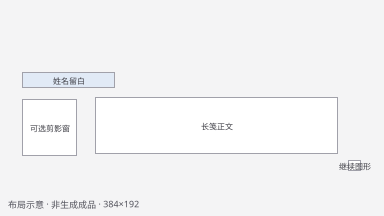

# 对白 · 墨色长笺

轻边界与大正文留白，让景物和叙事保持主次。

[返回总览](../README.md) · [对白详细拆解](../dialogue.md) · [机器可读JSON](game-ui-dialogue-ink-ledger.json) · [完整默认提示词](../prompts/game-ui-dialogue-ink-ledger.txt)

## 规格与范围

- 模板ID：`game-ui-dialogue-ink-ledger`；画风ID：`ink-ledger`。
- 逻辑画布：384×192；请求比例：2:1；正面平面UI。
- 默认透明背景、材质色轮廓。可以选择中性背景；JSON分别保存两种背景的真实编译结果。
- 生成目标是单张静态美术稿；本轮没有生成该模板的新成品。
- 中文、数量、价格和状态文案保留为运行时内容。

## 布局与预期视觉效果



归一化坐标基于完整逻辑画布，格式为x、y、width、height。它们只说明构图，不是引擎锚点、点击热区或切片边界。像素坐标是同一舍入规则的示意值。

| 区域 | 归一化坐标 | 示意像素坐标 |
|---|---|---|
| 姓名留白 | 0.06, 0.38, 0.24, 0.08 | 23, 73, 92, 15 |
| 可选剪影窗 | 0.06, 0.52, 0.14, 0.29 | 23, 100, 54, 56 |
| 长笺正文 | 0.25, 0.51, 0.63, 0.29 | 96, 98, 242, 56 |
| 继续图形 | 0.91, 0.84, 0.03, 0.05 | 349, 161, 12, 10 |

## 主体描述

中国南方乡村生活游戏的水墨色块对白UI美术，米白长笺与克制灰墨边，少量植物色点缀，安静自然。

可以把这段换成自己的物品和题材。软件保留独立的uiPreset规则；纯文本调用其他工具时，必须同时附上后面的完整约束块。

## 持久图像规则

1. 只生成一张游戏UI静态美术示意，采用正面平面投影与精致像素色簇；不是网页、工具后台或可运行界面，也不生成透视手机模型。
2. 按指定逻辑画布组织像素颗粒、边框和内边距，像素边缘清楚，避免照片材质、软糊描边和随意密集碎点；实际输出仍需本地像素校验。
3. 沿用项目参考的主题色、材质、轮廓与光源，不擅自改动已指定颜色；材质只装饰边缘和重点，主要信息区保持安静。
4. 动态中文、名字、数量、价格、货币数值和长说明由游戏运行时绘制；为它们留出明确空白信息区，不生成假字、乱码、占位横线、字母数字或烘焙文字。
5. 图形图标可表达功能，但布局必须给动态内容、选择和操作反馈留空间；仅画一个清楚的基础状态，不拼贴多页面、伪造交互过程或把状态说明写进画面。
6. 如需展示当前选中，只给一个对象清楚的静态边框或色块；不画焦点动画，不虚构锁定条件，也不把选中与不可用混成一种视觉状态。
7. 完整保留界面边框与安全内边距，空白区域不堆装饰；界面外背景服从所选背景规范，所需纸面、布面等控件内部保留设计的不透明材质。
8. 创造原创的器物符号、框体和分区，不照抄商业游戏的角色、商标、专属图标或可识别的布局细节，不添加品牌标志和水印。
9. 采用米白纸面、灰墨色块、克制的植物绿与单一朱红强调色；已有项目主题色优先，不把人物或物品强制改成黑白。
10. 水墨感由虚实留白、边缘节奏和有限墨色块表达，仍保持清晰像素边界；不使用模糊晕染或半透明毛边。
11. 采用下侧一张宽长笺，正文留白占主体，上沿保留小姓名签和可选小型人物剪影窗，右下只画简洁继续图形；长笺外侧背景服从所选规范，不画山水背景或装饰书法。

## 交互建议，未随图片实现

- 阅读区域位置稳定，角色切换不造成大幅布局跳动。
- 字幕、对白历史或重看功能若提供，应保持原文和顺序。
- 推进输入不与世界交互键在同一时刻重复触发。

## 状态验收建议

- 旁白与角色发言有可辨身份，不只改变墨色。
- 大字和多行文本不压住继续操作。
- 无肖像模式仍保留清楚的说话者信息。

上述两节不进入生图提示词，防止模型把交互说明画成界面文字。

## 实际参考

- [Stardew Valley · 底部宽对白框与右侧表情头像](../reference-atlas.md#ui-413150-4)
- [Eastward · 场景内近角色气泡与姓名](../reference-atlas.md#977880-3)
- [Sea of Stars · 深色轻面板与左侧情绪肖像](../reference-atlas.md#1244090-11)
- [Pentiment · 多人对答的书页式气泡](../reference-atlas.md#1205520-13)
- [Chained Echoes · 底部细长对白条与场景外接肖像](../reference-atlas.md#1229240-0)

## 完整默认提示词

下面直接由软件编译器导出，包含通用尺寸、像素、轮廓、光照、背景与所选布局规则。它是追加到请求prompt的文本，不是独立API system消息。

```text
中国南方乡村生活游戏的水墨色块对白UI美术，米白长笺与克制灰墨边，少量植物色点缀，安静自然。

【Pixel Studio 内置像素生成规范：对白 · 墨色长笺 v1】
- 内容：生成一张完整游戏UI静态美术稿，按所选界面方案组织功能区域。主体描述决定具体题材、物件和指定原色；所请求的头像或物品图形可进入各自区域，不额外添加外部场景。中文、数值和操作标签保持可变文本的空白区域，实际交互由游戏实现。
- 视角：正面正交投影（orthographic front view），水平线与竖线对齐画布像素轴，轮廓完整、无透视汇聚、无倾斜展示台和摄影景深。UI面板平直朝向使用者，图标以正面剪影优先表达辨识度，不添加屋顶俯视或地面斜轴。
- 像素密度：按384×192逻辑像素画布设计，所有物体和材质统一逻辑像素密度，每格只用一种颜色。该尺寸是绘制密度目标，不宣称服务商一定返回相同文件尺寸；较大文件只以均匀整数方块表现同一网格，不混用细碎高清纹理与大像素。
- 描边：采用材质本色的深色选择性轮廓，通常为1个逻辑像素；木、石、布、金属分别使用协调的深褐、深灰或深冷色。受光边适当省略或减弱轮廓，不给所有物体套纯黑粗框，不用双层描边或发光边。
- 只生成一张游戏UI静态美术示意，采用正面平面投影与精致像素色簇；不是网页、工具后台或可运行界面，也不生成透视手机模型。
- 按指定逻辑画布组织像素颗粒、边框和内边距，像素边缘清楚，避免照片材质、软糊描边和随意密集碎点；实际输出仍需本地像素校验。
- 沿用项目参考的主题色、材质、轮廓与光源，不擅自改动已指定颜色；材质只装饰边缘和重点，主要信息区保持安静。
- 动态中文、名字、数量、价格、货币数值和长说明由游戏运行时绘制；为它们留出明确空白信息区，不生成假字、乱码、占位横线、字母数字或烘焙文字。
- 图形图标可表达功能，但布局必须给动态内容、选择和操作反馈留空间；仅画一个清楚的基础状态，不拼贴多页面、伪造交互过程或把状态说明写进画面。
- 如需展示当前选中，只给一个对象清楚的静态边框或色块；不画焦点动画，不虚构锁定条件，也不把选中与不可用混成一种视觉状态。
- 完整保留界面边框与安全内边距，空白区域不堆装饰；界面外背景服从所选背景规范，所需纸面、布面等控件内部保留设计的不透明材质。
- 创造原创的器物符号、框体和分区，不照抄商业游戏的角色、商标、专属图标或可识别的布局细节，不添加品牌标志和水印。
- 采用米白纸面、灰墨色块、克制的植物绿与单一朱红强调色；已有项目主题色优先，不把人物或物品强制改成黑白。
- 水墨感由虚实留白、边缘节奏和有限墨色块表达，仍保持清晰像素边界；不使用模糊晕染或半透明毛边。
- 采用下侧一张宽长笺，正文留白占主体，上沿保留小姓名签和可选小型人物剪影窗，右下只画简洁继续图形；长笺外侧背景服从所选规范，不画山水背景或装饰书法。
- 轮廓节奏：采用连续、可读的像素簇；斜线和曲线用随形体渐变或有节奏交替的台阶，合法的2、3交替台阶应保留。避免无意的1像素反复凸凹、单点突刺、漂浮碎点和破碎边缘；有结构意义的耳尖、胡须、爪尖与细杆保持连贯，不靠模糊抹掉。
- 材质与颜色：每种材质通常用3–5个有意设计的明暗色阶，形成干净的成片色块；这不是全图限为3–5色。保留主体指定原色与材质差异，纹理用少数有结构的色簇表达，不随机抖色、不铺噪点、不使用抗锯齿（AA）、半透明边缘或软渐变。
- 光照：统一由屏幕左上方照亮，亮面、转折和右下暗面用明确色块表示；不使用柔焦、bloom、发光光晕或模糊投影，不混用多个光源。
- 主题继承：沿用主体描述或所提供项目参考的色彩角色、主光、材质与轮廓语言。UI正面投影和小人物的细节简化是用途差异，不借此另换整套画风；未提供色板时不虚构已锁定的项目色板。不擅自添加中式符号、屋瓦、灯笼、龙纹或花边，具体地域感由请求的真实服饰和生活材质表达。
- 背景：请求真实透明背景，物体外部与内部镂空均应透明，保留清楚的二值alpha边缘；不要用透明棋盘、格纹、彩色底板或背景插画冒充透明，不在边缘留下彩色污染或柔软光晕。
- 冲突处理：如果主体描述含不同视角、描边或像素密度，以本次所选规范为生产约束；主体指定的物体与内容仍须保留。不要把请求的像素外观当作已经通过网格或透明校验。
【规范结束；以上内容合并到请求提示词，输出仍须本地校验】
```

## 处理与验收

自动创建generation → pixel → cutout → export四节点；不是按区域拆分、九宫格切片或引擎UI实现。透明请求只是意图，仍要检查内部纸面/布面是否被去底误删、细装饰和原色是否保留、动态文字区是否完整。先在最终显示尺寸检查层级，再检查最近邻局部放大。软件精确参数及限制见[集成说明](../software-integration.md)。
