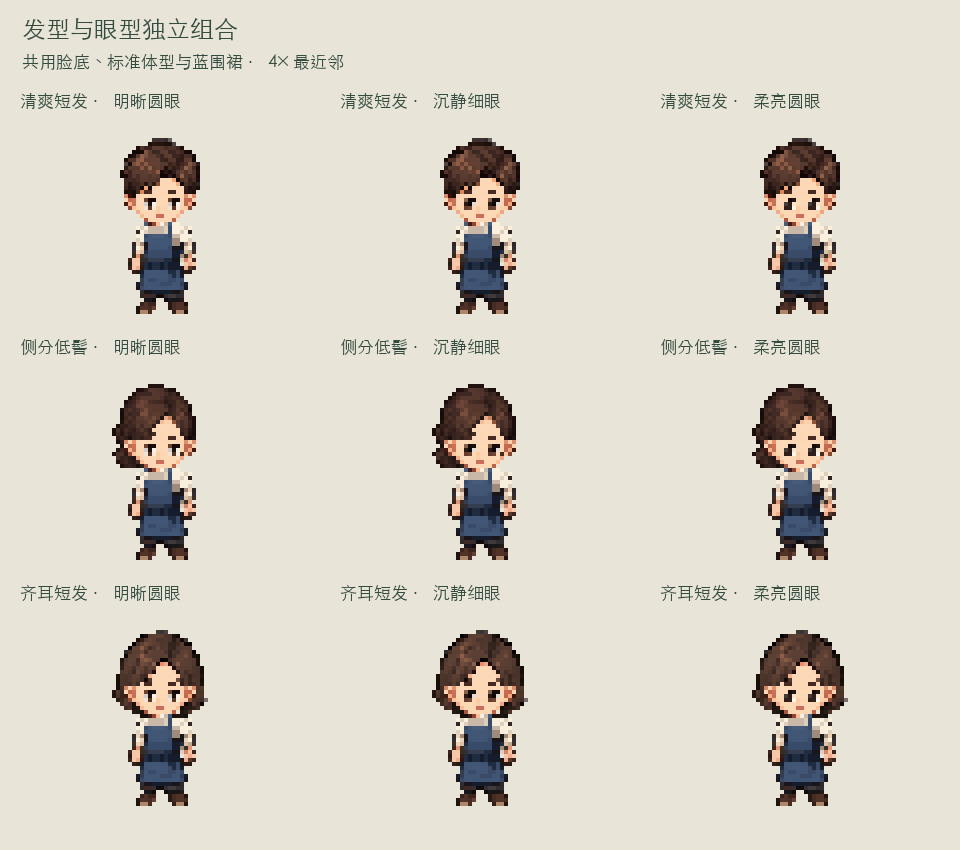

# 南乡 / 心乡 · 像素纸娃娃研究检查点

这里保存角色换装研发的可运行源码、真实PNG部件、来源记录和研究结论。**当前美术尚未获认可**：用户在V82反馈“感觉怪怪的”，本次先研究外部方法并保存现状；没有把组合测试通过写成造型定稿，也没有合入游戏主角。

## 快速查看

```sh
python3 tools/unpack.py
python3 tools/serve.py
```

打开 <http://127.0.0.1:3451/>。这是独立静态网页，无需Node、Studio、生图账户或网络。默认用3451避免占用原3450预览。`python3 tools/serve.py --port 8080`可改端口。



完整PNG、原始生成图和历史验证数据保存在 `archives/` 的四个校验归档中；源码与关键效果图可直接在仓库浏览。首次克隆先执行上面的解包命令，再运行或导入Godot。此存储方式保留完整内容，避免把数千个重复中间PNG散放在仓库目录中。

## 保存了哪些进度

| 入口 | 已实现 | 当前缺口 |
| --- | --- | --- |
| [V82 独立发眼体型与六衣](experiments/modular-v82/README.md) | 44px；3发型×3眼型×2体型×6衣装；染色；独立PNG；共享正面动作及8关键姿势；内部保留V81与V69入口 | 新模块仅正面；表情、脸型、发际线适配尚未完成；宽实是宽度模板；裙是刚性片；美术未认可 |
| [V70 Godot四向三衣共骨](experiments/native-four-direction-v70/README.md) | 原禾青四方向、3衣、15个Bone2D与195个Sprite2D，共用行走时钟 | 不是V82新角色；未合入捏脸、染色和装备；裙未做布料形变 |
| [V66 Godot饰品与剑锄](experiments/native-equipment-v66/README.md) | 原禾青正面、3衣、18个Bone2D、71个Sprite2D、头饰/背篓/剑锄与动作事件 | 未合入四向行走和V82；无命中、伤害或耕地玩法 |

三个原型各有明确边界，不能合计成一套已经全部完成的游戏系统。Godot项目用编辑器打开对应`project.godot`，历史验证版本为4.6.2；引擎不随仓库分发。历史`.command`与来源导出工具可能含原机器路径，跨机器请使用编辑器入口；网页运行通过上面的便携脚本。

## 文档与来源

- [研发进度与未完成项](docs/PROGRESS.md)
- [外部做法与下一轮方案](docs/research/README.md)
- [头部拆分文件](experiments/modular-v82/head/package/head-modules.json)
- [体型与服装适配合同](experiments/modular-v82/body/package/body-profiles.json)
- [原始交付包哈希](docs/source-archives.json)
- `source-art/v81/`：三位村民和六套衣装的自有工作流原始来源、提示词与任务收据。
- `experiments/modular-v82/head/runs/complete-face-base-v1/`：V82完整脸底的自有工作流来源。

没有调用新的生图任务，未包含API凭据、Studio数据库、模型权重、第三方商业素材或引擎二进制。素材来源说明见各实验目录；此研发快照不另行授予资产公开再分发许可。

## 复核

```sh
python3 tools/verify-checkpoint.py
```

该命令核对已归档实验/来源文件的SHA256以及网页本地入口依赖，证明搬迁未损坏内容；不把历史验证报告说成本次重新执行的动画/GPU测试。V82既有108组合、1212渲染与实际浏览器检查记录随包保留，当前美术反馈也同步记录。
